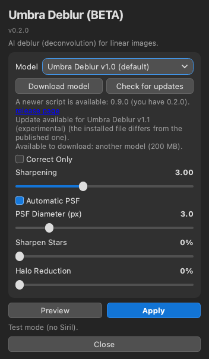
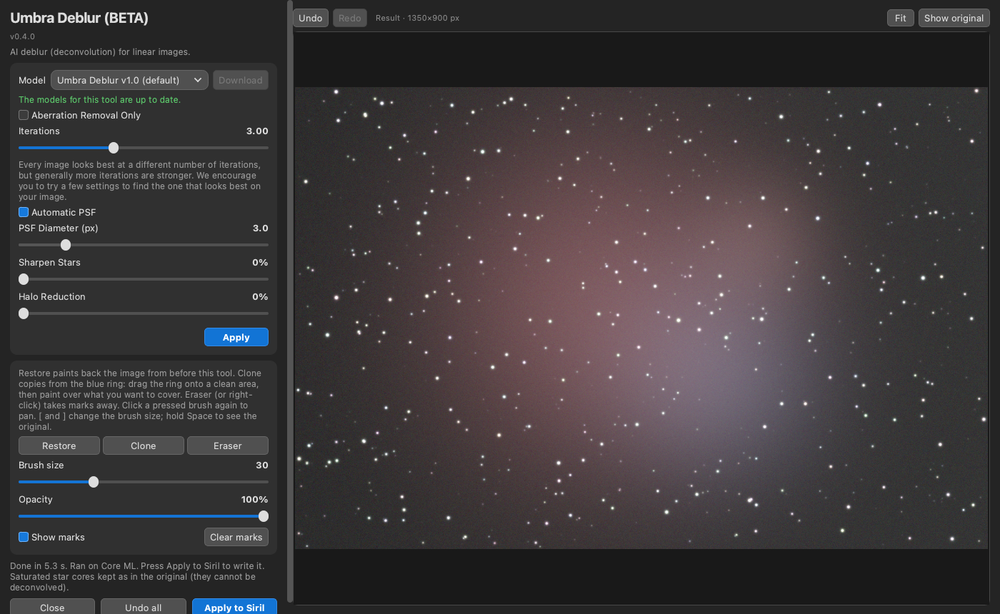

# Umbra Deblur (BETA)

Umbra Deblur is an AI deblur (deconvolution) tool for [Siril](https://siril.org), aimed at small-scope images (Seestar, Dwarf and similar) but usable on any linear image. It is a Siril Python script with an AI model. It runs locally on your computer and is free. It used to be called Umbra Deconvolve.

**Status: Beta (v0.3.0).** Expect rough edges.

*Screenshots (synthetic test image): the window before running, and after Apply.*

## Download and install

1. Download the single file [`Umbra_Deblur.py`](https://raw.githubusercontent.com/Kishanhpatel/umbra-deblur/main/Umbra_Deblur.py) (also attached to the [latest release](https://github.com/Kishanhpatel/umbra-deblur/releases/latest)). Save it in any folder you like. Siril has no standard scripts folder name.
2. In Siril open **Preferences > Scripts**, add that folder, refresh the list, then run **Umbra Deblur** from the Scripts menu.
3. First run: Siril installs the Python packages the script needs (numpy, onnxruntime, PyQt6, scipy, astropy). This can take a few minutes.
4. If no model is installed, the model drop-down lists it as "Umbra Deblur v1.0 (Not Downloaded)". Select it and press **Download**, right of the drop-down (about 199 MB). The file is checked with SHA-256 and saved in a folder named `Umbra Deblur` next to the script.

**Manual install.** Download the `.onnx` file from the [release page](https://github.com/Kishanhpatel/umbra-deblur/releases/latest) and put it in the `Umbra Deblur` folder next to the script. To use another folder, set `UMBRA_DEBLUR_MODEL_DIR` to it. `UMBRA_DEBLUR_MODEL` can point at one specific model file.

**Updates.** Each time the script opens, it checks the published list (`models/models.json`) for a newer script and for new or changed models. A line under the model row shows the result. In green: "The models for this tool are up to date." In yellow: "There is an update to this script available" or "There is a new model available for this tool, select the model in the dropdown and click Download to install." A model downloads only when you press **Download**. A newer script is shown as a link to the release page; the script never replaces itself. Nothing is sent about you or your computer (only a generic client name). With no network the installed models keep working. Set `UMBRA_DEBLUR_OFFLINE=1` (or `UMBRA_OFFLINE=1`) to turn the lookup off.

**Coming from Umbra Deconvolve 0.0.14?** This is the same project under a new name. Models in the old `Umbra Deconvolve` folder are used automatically (when the `Umbra Deblur` folder has none), so nothing downloads twice. The old repository link redirects here, and the old script keeps working with its old models. The environment variables changed from `UMBRA_DECONV_*` to `UMBRA_DEBLUR_*`.

## What it does

It measures the star shape (PSF) of your image, then runs the model for a number of passes to sharpen it. Controls:

- **Aberration Removal Only**: fixes star shapes (aberrations) without sharpening. Switches the Iterations, star and halo controls off.
- **Iterations** (0 to 8, steps of 0.25, default 3): the number of sharpening passes. Every image looks best at a different number of iterations, but generally more iterations are stronger; try a few settings to find the one that looks best on your image. Since v0.4.1 each pass takes the step size the models were trained with, so results level off after about 5 iterations. The star shape is measured again each pass. 2.5 means 2 passes plus a half-strength pass. 0 is the same as Aberration Removal Only. (Older models without this setting show **Strength** 0 to 100% instead.)
- **Protect star shapes (slower)**: only shown for v1.1 (experimental). Stars come from v1.0, which gives the best star shapes, and all other detail from v1.1. About twice as slow.
- **Automatic PSF** and **PSF Diameter (px)** (1.5 to 10): the star size is measured from the image by default. Switch off to set it by hand. Automatic PSF is greyed out, and you set PSF Diameter by hand, when the image has no stars, because the current models need stars to measure the PSF.
- **Sharpen Stars** (0 to 100%): shrinks stars toward the sampling limit. Only this slider changes star size. Default 0.
- **Halo Reduction** (0 to 100%): pulls star halos in and puts their light back into the star core. Default 0.

If the FITS header mentions drizzle, the noise estimate is raised, because drizzled stacks have correlated noise. If the image looks stretched, the status line warns you; the tool expects linear data.

**The window.** The window has a fixed-width controls column on the left and a large image area on the right. The image area shows the current image (auto-stretched) as soon as the window opens. Scroll or pinch to zoom and drag to pan. Double-click the image or press **Fit** to fit the whole image. Hold down **Show original**, or hold the Space key anywhere in the window, to compare with the image before the tool; release it to see the result again. **Undo** and **Redo** at the top left of the image area step back and forward through your Apply results (Cmd/Ctrl+Z and Cmd/Ctrl+Shift+Z); the last 10 steps are kept. The window keeps its size when you switch tools or models.

**Apply and Apply to Siril.** **Apply** (the small blue button inside the tool's panel) runs the tool on the whole image and shows the result in the image area. The star shape is measured on the whole image. The image in Siril is not changed. **Apply to Siril** writes the current result to the image in Siril as one step, so Siril's **Undo** goes back. If you changed the settings since **Apply**, it runs the tool first. Until then the image in Siril is not changed, whatever you do in the window. **Undo all** (bottom row, between **Close** and **Apply to Siril**) goes back to the image as it was when the window opened, and also puts it back in Siril if you had written anything; **Redo** can still bring the steps back. Siril's scripting interface cannot write a FITS HISTORY line, so the settings used are written to the Siril log (and into any extra FITS file the tool saves).

**Restore, Clone and Eraser brushes.** A second panel under the tool's settings is greyed out until **Apply** has made a result. Then:
- **Restore**: paint where you want the image from before this tool back (for example where the tool went too far).
- **Clone**: copies from the blue source ring, like the clone tool in Umbra Astro Studio. Drag the ring onto a clean area, then paint over what you want to cover. While you paint, a second ring shows where it is copying from, and the brush shows a preview of the patch.
- **Eraser** (or right-click with any brush): takes Restore and Clone marks away again.
- **Brush size** (keys **[** and **]** make it smaller and bigger), **Opacity**, **Show marks**, **Clear marks**.

Click a pressed brush again to go back to pan and zoom. The result updates after each stroke without running the AI again, and the brushes stay part of the same Apply step (one Undo removes it). Marks are cleared when the image the tool starts from changes.

**Command line.** `python Umbra_Deblur.py --image IN.fits --out OUT.fits` runs the tool without a window. Flags: `--sharpening 0..8`, `--stars`, `--halo`, `--correct-only` (the same function as **Aberration Removal Only**), `--fwhm PX`, `--protect-stars`, `--model PATH`. `--check-updates` and `--download [MODEL_ID|all]` work from the command line too, and `--help` lists everything.

## Models

Models are published as GitHub release assets and are not stored in this repository. See `models/models.json`.

| Name | File | Size | Notes |
|---|---|---|---|
| Umbra Deblur v1.0 (default) | `umbra_deblur_v1.0.onnx` | 199 MB | Clean, stable medium-scale sharpening. Best star shapes. |
| Umbra Deblur v1.1 (experimental) | `umbra_deblur_v1.1_experimental.onnx` | 199 MB | Joins fine 1 to 4 pixel strands better. Turns on a sky mask automatically. May change. |

Old names (Umbra Deconvolve 0.0.14), same files:

| Old name | Old file | New name | New file |
|---|---|---|---|
| Umbra Deconvolution 1.0 | `umbra_deconvolution_1.0.onnx` | Umbra Deblur v1.0 | `umbra_deblur_v1.0.onnx` |
| Umbra Deconvolution 1.1a experimental | `umbra_deconvolution_1.1a_experimental.onnx` | Umbra Deblur v1.1 (experimental) | `umbra_deblur_v1.1_experimental.onnx` |

The old files are byte-for-byte the same models. If you already have them they keep working.

## Strengths

- Sharpens medium-scale detail cleanly, and stays stable up to 8 Iterations on most targets (tested on a 22-image test bank).
- Dark dust lanes get narrower instead of turning into blobs.
- Stars stay round. Sky grain is checked and not increased.
- Handles starless images, drizzled data and saturated stars.
- v1.1 joins fine strands better (for example the Arp 273 arcs, Crescent Nebula strands and the inner M51), and has an optional "Protect star shapes" box.
- GPU acceleration with automatic CPU fallback.

## Weaknesses

- Very fine (1 to 4 pixel) detail is the weak spot. It is most visible inside bright cores (the inner M51 bulge, the Centaurus A core), where filaments stay smooth or break into beads.
- At high Iterations faint, smooth nebulosity (for example the dust around the Horsehead) can turn into blobby texture, and some galaxies can show mild pits or beading. v0.4.1 reduced this a lot; back off if you still see it.
- v1.1 can leave coma-like tails on bright corner stars unless "Protect star shapes" is on. That costs roughly 1.5 to 2 times the run time.
- Star peaks can go above 1.0 at high settings, so save results as 32-bit float.
- Linear data only. Stretched images are not what it was made for.
- Tested mainly on the author's own data and one Mac.

## GPU acceleration

The GPU is used by default whenever one can be used, and the CPU only as a fallback. Providers are tried in this order: CUDA (NVIDIA), DirectML (Windows), ROCm and MIGraphX (AMD on Linux), OpenVINO (Intel), Core ML (Mac), then CPU. Each one is checked against the CPU result on a small probe tile before it is used; if it fails or the result differs, the script falls back to the CPU. The status line says which one ran ("Ran on ..."). Set `UMBRA_DEBLUR_CPU=1` to force the CPU.

On first run the script installs the onnxruntime package that gives your system a GPU:

- **Mac:** `onnxruntime` (Core ML, Apple GPU, built in).
- **Windows:** `onnxruntime-directml` (any DirectX 12 GPU: NVIDIA, AMD or Intel; no extra downloads).
- **Linux with an NVIDIA GPU:** `onnxruntime-gpu` (CUDA). If the system has no CUDA 12 / cuDNN 9 libraries, NVIDIA's own pip packages of them are installed too (a one-time download of about 2 to 3 GB).
- **Linux with AMD or Intel graphics:** there is no GPU build that installs automatically, so these run on the CPU. If you install `onnxruntime-rocm`, `onnxruntime-migraphx` or `onnxruntime-openvino` yourself in Siril's Python, the script uses it.

## Testing

Be aware of what has and has not been tried. This is a beta.

Tested:
- macOS 26 on an Apple M3, with Core ML and with the CPU.
- Standalone (command line and window test) and inside Siril 1.4.5 run headless (`siril-cli` with `pyscript`): read the image, process it, write it back with an Undo state, save.
- The window was tested offscreen only.
- v0.4.0: the shared history (Apply, Undo, Redo, Apply to Siril, Undo all), the brushes (including Clone) and the Space / [ ] keys were tested offscreen with a stand-in for Siril and synthetic mouse drags, not yet in the Siril window itself.

NOT tested:
- Windows and Linux.
- CUDA, DirectML and ROCm (the code is written; please report what you see).
- Intel Macs.
- The interactive window inside the Siril GUI.

Parity with the earlier versions: on real 768 px crops (three targets, both models, Iterations 0, 3 and 6, Protect star shapes on, a mono crop, a 300 x 250 crop and a crop with a NaN hole) the output is identical to the previous Umbra Deconvolve 0.0.14 (maximum difference 0). That version matched the original PyTorch version to 0.01 to 0.07 noise sigma. Core ML and CPU differ by at most 0.02 sigma.
Small images: the model uses fixed 512 px tiles. A 300 x 250 crop matched the reference exactly, but only one small case was tried.

## Layout

- `Umbra_Deblur.py`: the script (v0.3.0, ONNX Runtime, with model download and update check)
- `models/models.json`: model manifest (name, version, download URL, SHA-256, size)
- `docs/screenshots/`: panel screenshots
- `LICENSE`, `LICENSE-MODELS.md`: licenses

## Contact

Bugs or questions: umbraastrolabs@gmail.com, or open an issue on GitHub.

## License

- Script: GPL-3.0-only (see `LICENSE`).
- Models: CC BY-NC-SA 4.0, non-commercial (see `LICENSE-MODELS.md`).
